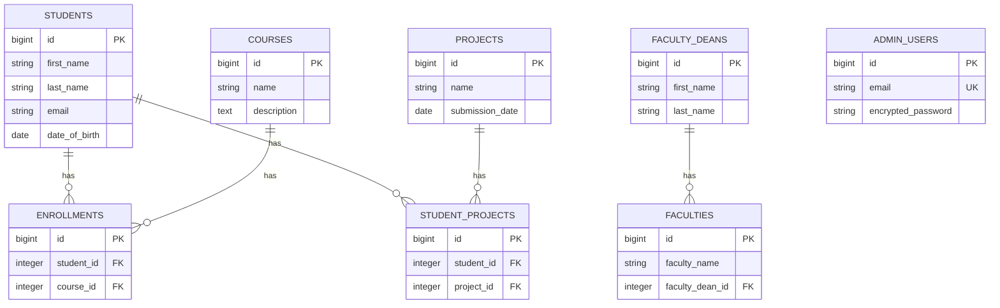

# Black Swan University

Black Swan University is a Ruby on Rails application for maintaining university student, course, and project records. It provides authenticated administrative workflows for student, course, and project management, backed by a PostgreSQL database.

## Project Overview

The application gives administrator accounts a central interface for creating, viewing, updating, and deleting student, course, and project records. Student records include contact and address details, a date of birth, and an optional profile image. The data model also represents course enrolments and student-project assignments.

The implemented management interface is aimed at administrators. The repository does not document broader institutional workflows or define separate permissions for different administrator roles.

## Key Features

- Student record management with name, email, contact, address, date-of-birth, and profile-image fields.
- Student name and email validation, including required fields, name format and length checks, email format, and application-level email uniqueness.
- Student list search through Ransack and paginated student and course lists.
- Course record management with required name and description and minimum length checks.
- Project record management for project names and descriptions.
- Enrollment and student-project association records in the data model.
- Devise-based administrator authentication. The student, course, and project resource controllers require an authenticated administrator.
- JSON responses for course and project resources through Jbuilder templates.

The models support student-course and student-project relationships. The current forms do not provide an interface for assigning students to courses or projects. Project model validations are not defined in the inspected model.

The schema includes a `submission_date` column for projects, but the current project form and controller do not expose it for editing.

## Technology Stack

Versions below are taken from `.ruby-version`, the Gemfile constraints, and `Gemfile.lock`.

| Technology | Version / role |
| --- | --- |
| Ruby | 3.2.9 |
| Ruby on Rails | 8.1.4.1 (Gemfile constraint: `~> 8.1.4`) |
| PostgreSQL | Database adapter: `pg` 1.7.0 |
| Puma | 8.0.2 web server |
| ERB | Rails view templates |
| Hotwire Turbo | `turbo-rails` 2.0.23 |
| Stimulus | `stimulus-rails` 1.3.4 |
| Importmap | `importmap-rails` 2.2.3 |
| Tailwind CSS | `tailwindcss-rails` 4.7.0 |
| Devise | 5.0.4 authentication |
| RSpec Rails | 8.1.0 |
| Factory Bot Rails | 6.5.1 |
| Shoulda Matchers | 8.0.1 |
| Capybara / Selenium WebDriver | 3.40.0 / 4.44.0 for browser and system testing |

Other application dependencies include Ransack for search, Kaminari and Pagy for pagination support, Jbuilder for JSON views, and Active Storage for profile-image attachments. Rails Minitest is also present as the default test framework.

## Application Architecture

This is a conventional Rails application. Controllers handle HTTP requests, Active Record models define persistence and associations, and ERB templates render HTML. Importmap, Turbo, and Stimulus provide the JavaScript integration, while Tailwind CSS is used for styling.

The main data relationships are:

- A `Student` has many `Courses` through `Enrollments`; each enrollment belongs to one student and one course. The schema has a unique index on the student/course pair.
- A `Student` has many `Projects` through `StudentProjects`; each join record belongs to one student and one project.
- A `FacultyDean` has many `Faculties`; each faculty belongs to a faculty dean.
- `AdminUser` records are separate and provide the identities used by Devise authentication.



## Prerequisites

- Ruby 3.2.9 (as specified in `.ruby-version`).
- Bundler compatible with the checked-in lockfile.
- PostgreSQL and a local PostgreSQL role/database configuration compatible with `config/database.yml`.
- Git to clone the repository.

The repository also includes image-processing dependencies. The CI workflow installs `libvips`; local image variant processing may require the corresponding system library.

## Installation and Setup

1. Clone the repository and enter its directory:

   ```sh
   git clone <repository-url> black-swan-university
   cd black-swan-university
   ```

2. Select Ruby 3.2.9 using your Ruby version manager, then install the locked Ruby dependencies:

   ```sh
   bundle install
   ```

3. Make sure PostgreSQL is running. Review `config/database.yml` and configure its local development connection to match your PostgreSQL setup. Do not commit credentials or other secrets.

4. Create the development database and apply its migrations:

   ```sh
   bin/rails db:create
   bin/rails db:migrate
   ```

   Run database setup only against your intended local development database. Migrations update the database schema.

5. Start the Rails server:

   ```sh
   bin/rails server
   ```

No additional application environment variables are required by the inspected development configuration. `RAILS_MAX_THREADS` is optional and defaults to `5` for the database connection pool.

## Database

The application uses PostgreSQL through Active Record. Development and test database names and connection parameters are defined in `config/database.yml`; configure local PostgreSQL access there before database setup. The test environment has a separate database entry.

Schema changes are represented by timestamped files in `db/migrate/` and reflected in `db/schema.rb`. Create and review migrations when changing persistent data structures, then apply them to the intended environment with Rails migration tasks. Do not use destructive database commands to set up a development environment.

## Running the Application

Run the development server from the repository root:

```sh
bin/rails server
```

Then visit [http://localhost:3000](http://localhost:3000). The root route renders the welcome page. Student, course, and project management routes require administrator sign-in.

## Testing

The repository contains both RSpec specs under `spec/` and Rails Minitest tests under `test/`.

Run the RSpec suite:

```sh
bundle exec rspec
```

Run the Rails Minitest suite:

```sh
bin/rails test
```

Run Rails system tests:

```sh
bin/rails test:system
```

RSpec coverage includes model, request, feature, and system specs. Minitest coverage includes model and controller tests. The GitHub Actions workflow runs Minitest and Rails system tests; it does not currently invoke RSpec. No test results are reported here because the suites were not run while preparing this documentation.

## Project Structure

| Path | Purpose |
| --- | --- |
| `app/models/` | Active Record models and model concerns |
| `app/controllers/` | Request handling, including student, course, and project resources |
| `app/views/` | ERB pages, partials, and Jbuilder JSON templates |
| `app/javascript/` | Importmap JavaScript entry points and Stimulus controllers |
| `app/assets/` | Stylesheets, images, and compiled asset files |
| `config/` | Routes, database settings, environments, and initializers |
| `db/migrate/` | Database schema migrations |
| `db/schema.rb` | Current Active Record schema snapshot |
| `spec/` | RSpec examples and Factory Bot factories |
| `test/` | Rails Minitest tests and fixtures |
| `.github/workflows/` | GitHub Actions CI configuration |

## Security Considerations

- Devise provides database-backed administrator authentication, including password hashing, recovery, remember-me, tracking, and confirmation modules.
- Student, course, and project resource controllers enforce sign-in with Devise's `authenticate_admin_user!` callback.
- Devise registration routes are enabled. The inspected code does not show role-based authorization or additional permission policies.
- Rails parameter filtering is configured for common sensitive fields, including passwords, tokens, and keys.
- The checked-in database configuration contains local connection settings. Keep real credentials out of version control and review configuration before using non-local environments.
- The content security policy initializer contains Rails' commented example configuration; an enforced custom policy is not configured there.

## Future Improvements

The following are potential improvements, not claims about completed functionality:

- Confirm whether administrator self-registration should remain enabled, and add roles or authorization policies if different access levels are required.
- Move database connection secrets out of tracked configuration and document a secure local setup method.
- Add interface workflows and tests for assigning students to courses and projects if those workflows are in scope.
- Expose the project submission date in the project workflow if users should manage it.
- Expand RSpec coverage and include the RSpec suite in CI if it is intended to be maintained as a primary test suite.

## Author

👤 **Gladwin Tshepo Ramantso**

- GitHub: [@tsheporamantso](https://github.com/tsheporamantso)
- Twitter: [@ramgt001](https://twitter.com/ramgt001)
- LinkedIn: [Tshepo Gladwin Ramantso](https://www.linkedin.com/in/tshepo-ramantso-b6a35433/)

## License

No license file or explicit license declaration was found in the repository. No license is stated here.
